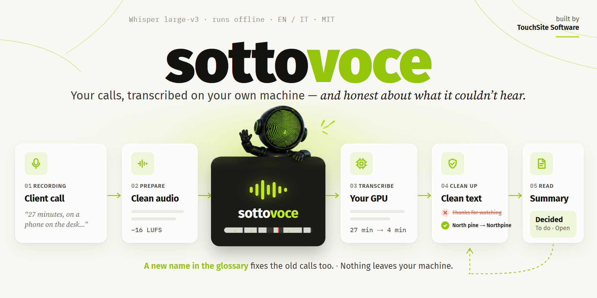
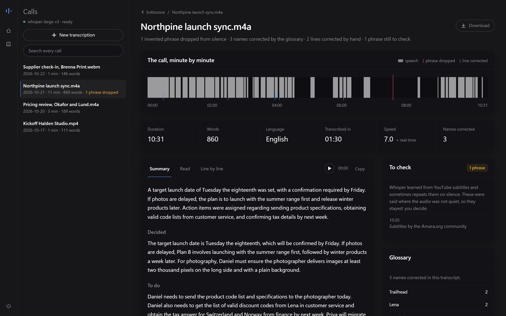

# Sottovoce



**Trascini nella pagina la registrazione di una call, oppure registri la call da lì. Ti torna la trascrizione, chi ha detto cosa, un riassunto, e la mappa dei punti in cui il testo non è affidabile.** Whisper large-v3 sulla tua GPU. Niente esce dalla tua macchina.

[](https://github.com/thetouchsite/sottovoce/actions/workflows/tests.yml)

[English](README.md) · [Provalo senza GPU](#provalo-in-un-minuto-senza-gpu) · [Registrare una call](#registrare-una-call) · [Cosa abbiamo misurato](#cosa-abbiamo-misurato) · Licenza MIT

Creato da [TouchSite Software](https://www.touchsitesoftware.it).


<sub>Una call dimostrativa inventata. In queste immagini non c'è nessun dato reale di clienti.</sub>

> L'interfaccia è in inglese. La trascrizione e il riassunto seguono la lingua della call: un file in italiano esce in italiano.

## Perché

I programmi di trascrizione ti consegnano un blocco di testo che sembra ugualmente sicuro dappertutto. Su una call di lavoro vera, registrata col telefono appoggiato sulla scrivania, non lo è. Gli errori che costano di più sono tre, e sono proprio quelli che non si vedono:

- **Frasi che nessuno ha detto.** Sul silenzio Whisper scrive i sottotitoli di YouTube su cui è stato addestrato: *«Grazie a tutti»*, *«Sottotitoli a cura di…»*.
- **Nomi che poi non ritrovi.** L'azienda del cliente esce scritta in cinque modi diversi: la ricerca non la trova e il riassunto la storpia.
- **Nessun modo di verificare.** Non sai di quale parte del testo dubitare, se non riascoltando tutta la call.

Sottovoce risolve i primi due, e per il terzo ti mostra dove guardare.

| Passo | Cosa succede | Perché c'è |
| --- | --- | --- |
| 1 · Prepara | 16 kHz mono, volume normalizzato, mappa del parlato | Whisper diventa **il 35% più veloce** sull'audio da telefono normalizzato |
| 2 · Trascrive | Whisper large-v3 in modalità lunga, con le soglie anti-allucinazione | Spezzando in blocchi usciva la stessa frase **40 volte di fila** |
| 3 · Ripulisce | Butta le frasi da sottotitoli *solo* dove l'audio è 12 dB sotto il parlato; applica il glossario | Un «grazie a tutti» detto davvero resta, quelli inventati no |
| 4 · Si legge | Riassunto, paragrafi, riga per riga, la striscia della call, parole cliccabili | Clicchi la striscia o una parola e ascolti proprio il punto che ti lascia dubbi |

## Cosa lo rende diverso

- **Ti dice dove non fidarti.** La *striscia della call* mostra tutta la registrazione in una banda: dove si parla, dove c'è silenzio, dove è stata buttata una frase inventata, dove una riga è stata corretta. Clicchi in un punto qualunque e ascolti da lì.
- **Registra anche la call, e sa chi parla.** Registri una call di Google Meet, Zoom o Teams direttamente dalla pagina: il tuo microfono e la scheda della call finiscono su due tracce separate, quindi la trascrizione dice *You* e *Them* senza nessun modello di riconoscimento delle voci.
- **Ogni impostazione è stata misurata.** Su una call vera, contro le alternative, con i numeri [qui sotto](#cosa-abbiamo-misurato): compresi i quattro tentativi che non hanno funzionato.
- **I nomi si correggono dopo, non si suggeriscono prima.** Passato a Whisper come prompt, il glossario peggiorava il testo. Qui è una tabella di correzione, e quando aggiungi un nome la puoi riapplicare anche alle call vecchie.
- **Le tue correzioni restano.** Ogni riga che correggi viene salvata col *prima* e col *dopo*: il materiale che serve per addestrare un modello sulle tue call.
- **Riassunti col tuo LLM.** Se è acceso LM Studio, Ollama o llama-server ottieni *Deciso / Da fare / Aperto*, nella lingua della call. Se non c'è nessuno acceso, il bottone semplicemente non compare.
- **Niente esce dalla macchina, e niente è nascosto.** Il server ascolta solo su `127.0.0.1`. La pagina non carica niente da internet, nemmeno il carattere. Ogni call è una cartella di file normali: niente database, niente account, niente telemetria.


## Avvio rapido (Windows)

Serve una GPU NVIDIA con circa 4 GB di VRAM libera, e Python 3.10 o più recente (provato su Windows 11, Python 3.14, RTX 5090; i test girano su 3.10 e 3.14).

```sh
git clone https://github.com/thetouchsite/sottovoce
cd sottovoce
Install.bat
Start.bat
```

`Install.bat` crea l'ambiente virtuale e installa PyTorch con CUDA **prima** di tutto il resto (vedi [la trappola di PyTorch](#la-trappola-di-pytorch)), e alla fine ti dice se vede la GPU. `Start.bat` apre <http://127.0.0.1:8200>. Al primo avvio scarica il modello (2,9 GB, una volta sola) e lo carica nella VRAM in una ventina di secondi.


La pagina si apre su **New transcription**: a sinistra trascini uno o più file, a destra registri una call. 27 minuti di call richiedono circa 4 minuti. La lingua viene riconosciuta, oppure la scegli dal menu, e la scelta viene ricordata. Il server si spegne col bottone di accensione, oppure con `Stop.bat`.

**Linux e macOS:** il codice Python è multipiattaforma e i test girano su Ubuntu, ma i lanciatori sono per Windows.

```sh
python -m venv .venv && source .venv/bin/activate
pip install torch --index-url https://download.pytorch.org/whl/cu130   # adatta alla tua versione di CUDA
pip install -r requirements.txt
cp glossary.example.txt glossary.txt
python server.py
```

Su Mac non c'è CUDA: gira sulla CPU, circa dieci volte più lento.

## Provalo in un minuto, senza GPU

La cartella [`examples/`](examples/) contiene quattro call inventate, già trascritte: una in italiano, una registrata su due tracce. Le sfogli senza scaricare il modello:

```sh
pip install fastapi uvicorn python-multipart
python server.py --no-model --data examples/transcripts --glossary examples/glossary.txt
```

Poi apri <http://127.0.0.1:8200>. Striscia, riassunto, chi parla, ricerca, correzioni, download e glossario funzionano tutti; sono spenti solo la trascrizione e la registrazione.

## Registrare una call

In **New transcription** dai un nome alla call e premi **Start recording**. Il browser chiede quale scheda condividere: scegli quella della call e lascia attivo **Condividi anche l'audio della scheda**. Parli. Quando la call finisce, premi **Stop and transcribe**.

- **Due tracce.** Il tuo microfono va sul canale sinistro, la scheda della call sul destro. La traccia della call non contiene mai la tua voce, perché il programma della riunione non te la rimanda indietro. Quindi *chi parla* è una misura: ogni parola va alla traccia che in quel momento è più forte del suo solito. Le righe si spezzano dove cambia chi parla.
- **Audio pulito.** Il suono della call viene preso così come lo riproduce il browser, non da un telefono sulla scrivania. Era la radice della maggior parte dei problemi misurati qui sotto.
- **Non si perde niente se la pagina si chiude.** La registrazione arriva al server ogni cinque secondi. Se chiudi la scheda, il browser si blocca o il portatile va in sospensione, la volta dopo la pagina ti ripropone la registrazione interrotta: la trascrivi, o la cancelli.
- **Dove funziona.** Chrome o Edge su un computer, per le call che girano in una scheda del browser (Google Meet, Zoom e Teams nella versione web). Firefox e Safari non sanno catturare il suono di un'altra scheda. Le call nelle app desktop richiedono la cattura dell'audio di sistema, che è nei [prossimi passi](ROADMAP.md).
- **Usa le cuffie**, altrimenti il microfono sente anche gli altri. **Avvisa gli altri che stai registrando**: a seconda di dove ti trovi, può essere un obbligo.

## Cosa abbiamo misurato

Questi numeri vengono da **una sola call di lavoro vera, di 27 minuti, in italiano**, registrata col telefono sulla scrivania. È una call, non una batteria di test. Ma è esattamente l'audio per cui nasce questo strumento, mentre le classifiche pubbliche misurano parlato letto in studio.

Non c'era una trascrizione fatta a mano da usare come riferimento, quindi il tasso d'errore sulle parole non si poteva calcolare. Il metro è la **percentuale di parole che non esistono nella lingua** (verificata con [`wordfreq`](https://github.com/rspeer/wordfreq)). Un modello che allucina non produce rumore: produce parole plausibili che non esistono. Questo metro non vede una parola vera messa al posto sbagliato, ma la parola inventata è l'errore che blocca chi legge. Gli script sono in [`research/`](research/).

### Quale modello

| | parole inesistenti | tempo su 27 min | timestamp | frasi inventate |
|---|---|---|---|---|
| **whisper-large-v3** | **1,2%** | 168 s | sì | 3 |
| whisper-large-v3-turbo | 2,2% | 50 s | sì | 4 |
| parakeet-tdt-0.6b-v3 | 2,8% | 355 s | no | 0 |

La differenza si vede sui nomi propri. Il nome di un'azienda usciva da Parakeet scritto in otto modi diversi, da large-v3 quasi sempre nello stesso modo. Turbo è tre volte più veloce e sbaglia il doppio: su 27 minuti fa risparmiare due minuti.

**Attenzione al campione.** Sui primi 5 minuti i tre modelli sembravano equivalenti (1,6% / 2,2% / 2,1%). La differenza è emersa solo con 2.500 parole invece di 600.

### Tre cose che hanno contato più del modello

1. **Normalizzare il volume prima di trascrivere.** L'audio da telefono ha una voce vicina al microfono e le altre che escono dall'altoparlante: media -29,8 dB, picchi a -0,9. Normalizzato, il testo non cambia, ma Whisper diventa **il 35% più veloce**, perché su un segnale debole scarta e riprova le finestre incerte.
2. **Usare la modalità lunga di Whisper, non `chunk_length_s`.** Spezzando in blocchi da 30 secondi uscivano timestamp che tornavano indietro, e le stesse tre parole **quaranta volte di fila**.
3. **Impostare le soglie anti-allucinazione** (fallback di `temperature`, `compression_ratio_threshold`, `logprob_threshold`, `no_speech_threshold`, `condition_on_prev_tokens=False`). Senza, una ripetizione si autoalimenta da una finestra all'altra.

Il modello giusto configurato male dà risultati peggiori del modello sbagliato configurato bene.

### Togliere le frasi inventate: cinque tentativi, quattro falliti

| approccio | parole inesistenti | frasi inventate |
|---|---|---|
| niente | 31 (1,2%) | 3 |
| tagliare tutto il silenzio prima di trascrivere | 42 (1,7%) | 0 |
| tagliare solo le pause oltre i 3 s | 47 (1,8%) | 0 |
| trascrivere separatamente i tratti di parlato | 30 (1,2%) | 2 |
| **buttare le frasi da sottotitoli solo dove l'audio è 12 dB sotto il parlato** | **30 (1,2%)** | **0** |

Cosa abbiamo imparato:

- **A Whisper il silenzio serve.** Tagliarlo (l'approccio di WhisperX) toglie le allucinazioni, ma toglie anche l'indizio di dove finiscono le parole. Il danno lo fa il taglio in sé, non la quantità tagliata.
- **`silencedetect` non misura il volume.** Cerca tratti muti di una durata minima, e basta un fruscio a interrompere il conteggio. Segnalava «100% parlato» in un punto che misurava -43,9 dB.
- **Il volume medio di un file non è il livello del parlato.** Il silenzio abbassa la media e rende la soglia troppo indulgente. Il riferimento va misurato solo dove si parla.

### I nomi: correggerli dopo, non suggerirli prima

Whisper accetta un prompt iniziale (`prompt_ids`) per dirgli quali nomi aspettarsi. È il metodo documentato, quindi l'abbiamo provato:

| | segmenti | parole inesistenti |
|---|---|---|
| senza prompt | 552 | 44 (1,7%) |
| glossario come prompt | **166** | **67 (2,6%)** |

Il prompt destabilizza il modello: lo manda in tirate lunghe (i segmenti crollano da 552 a 166) e gli fa cercare quei nomi dappertutto. Per questo il glossario è una tabella di correzione deterministica, applicata al testo prodotto. Sulla call di prova ha sistemato 27 occorrenze di cinque nomi.

### I tempi delle parole: precisi, o il doppio più veloci

Whisper sa dare il tempo di ogni parola da solo, senza scaricare un secondo modello. Stessa call:

| | tempo | parole inesistenti | tempi delle parole |
|---|---|---|---|
| **predefinito** | **200 s** | 29 su 2.504 (1,2%) | il tempo di ogni riga diviso fra le sue parole, in base alla lunghezza |
| tempi precisi | 395 s | 29 su 2.500 (1,2%) | dall'allineamento di Whisper |

Stessa qualità, tempo doppio: i tempi precisi richiedono i pesi di attenzione del modello, e questo spegne la sua attenzione veloce. Per questo il predefinito tiene la velocità, e cliccando una parola si salta vicino a lei. Spunta **Precise word timings** (o `--precise`) quando deve cadere esattamente sulla parola. Il testo nelle due modalità non è identico parola per parola, ma la qualità è la stessa.

### Il riassunto: conta il backend, non il modello

Stessa GPU, stessa trascrizione di 3.760 token:

| configurazione | lettura del prompt | riassunto completo |
|---|---|---|
| llama.cpp build **Vulkan**, modello 9B (Q4) | 6,8 token/s, misurati | circa 9 minuti, stimati |
| llama.cpp build **CUDA** via LM Studio, Gemma 4 E4B (Q4) | non riportata | **16 secondi**, misurati |

Le due prove usavano modelli diversi, quindi il confronto non è pulito. Ma un modello 9B è circa due volte più lento di un 4B, non trenta. Il resto lo fa il build: la RTX 5090 è `sm_120` e il build Vulkan non la sfrutta. Non dà errore: va piano e non dice niente. Se i riassunti ci mettono minuti, sospetta prima di tutto il build.

## La trappola di PyTorch

Se installi `transformers` da solo, pip si porta dietro il PyTorch predefinito da PyPI. Sulle schede RTX serie 50 (Blackwell, `sm_120`) quella versione non vede la GPU: funziona tutto, sulla CPU, dieci volte più lento, e niente te lo segnala. PyTorch va installato **per primo**, dall'indice CUDA, ed è quello che fa `Install.bat`. Per verificare:

```sh
.venv\Scripts\python.exe -c "import torch; print(torch.__version__, torch.cuda.is_available())"
```

Deve stampare una versione che finisce in `+cu130` e `True`.

## Riassunti

I riassunti li scrive un LLM che hai già acceso sulla tua macchina, interrogato tramite l'API compatibile con OpenAI. Sottovoce lo cerca su queste porte: LM Studio `1234`, Ollama `11434`, llama-server `8080`. Niente da installare in più, e nessuna VRAM occupata quando non ti serve: Whisper prende 3 GB, un LLM utile altri 5-16. In una call registrata su due tracce il modello sa chi ha detto ogni riga, quindi *Da fare* può dire chi fa cosa.

Con LM Studio:

```sh
%USERPROFILE%\.lmstudio\bin\lms.exe server start
```

Il riassunto viene salvato come `summary.md` nella cartella della call, e la volta dopo si legge dal disco. **Redo** ne scrive uno nuovo. Riapplicare il glossario cancella il riassunto, perché era stato scritto sul testo vecchio.

## Il glossario

```text
# glossary.txt
Northpine <- North pine, Nord pine
Trailhead <- Trail head
```

Il confronto ignora maiuscole e minuscole e rispetta i confini delle parole. Puoi modificare il file, oppure usare la vista glossario nella pagina (l'icona del libro), che aggiunge righe senza toccare i tuoi commenti. Dopo aver aggiunto un nome, apri una call vecchia e premi **Apply the glossary again**. Ogni modifica finisce in `corrections.jsonl` col prima e col dopo, quindi si può annullare, e i tempi delle parole seguono il testo corretto.

`glossary.txt` è escluso da git, perché contiene i nomi dei tuoi clienti. La repo include invece `glossary.example.txt`.

## Download

Ogni call si scarica in `.md` (paragrafi, da leggere o incollare), `.txt` (riga per riga, coi minuti), `.srt` e `.vtt` (sottotitoli), e `.json` (righe, chi parla e tempi delle parole, per altri programmi). Gli ultimi tre si scrivono dalla trascrizione com'è in quel momento, correzioni comprese.

## Com'è fatta una call sul disco

```text
transcripts/
  2026-10-21_Northpine launch sync/
    Northpine launch sync.m4a    la registrazione originale, accanto alla sua trascrizione
    Northpine launch sync.txt    [mm:ss] testo, o [mm:ss] [Me] testo: la fonte di tutto il resto
    Northpine launch sync.md     in paragrafi, da leggere o incollare
    words.json                   quando è stata detta ogni parola, riga per riga
    info.json                    durata, lingua, tempi, cosa è stato buttato, mappa del parlato
    corrections.jsonl            ogni riga corretta, col prima e col dopo
    summary.md                   se l'hai chiesto
```

`transcripts/` è escluso da git: le registrazioni e i clienti restano sulla tua macchina.

## Riga di comando e API

```sh
python transcribe.py "Call cliente.mp4" --language it --formats txt,md,srt   # accanto al file
python transcribe.py "Registrazione.webm" --two-tracks --precise
python summary.py "Call cliente.md"                                          # col LLM locale
python server.py --port 8300 --data D:\call --glossary D:\call\nomi.txt
python server.py --no-model                                                  # sfoglia, senza GPU
```

`--language` accetta un codice Whisper (`it`, `en`, `de`…). Se lo ometti, la lingua viene riconosciuta.

Tutto quello che fa la pagina passa da una piccola API HTTP, documentata su <http://127.0.0.1:8200/docs> mentre il server è acceso: mandare un file dai tuoi script, leggere una call in JSON, cercare, correggere. Quella pagina di riferimento è di FastAPI e carica Swagger UI da una CDN quando la apri; la pagina dell'app no.

## Sviluppo

```sh
pip install -r requirements-dev.txt
pytest tests/test_engine.py tests/test_api.py      # motore e API, senza GPU, circa un secondo

pip install playwright && playwright install chromium
pytest tests/test_page.py                          # la pagina in un browser vero
```

I test girano sulle call inventate di `examples/`, col server avviato `--no-model`, a ogni push: Ubuntu e Windows, Python 3.10 e 3.14. La trascrizione vera richiede una GPU e si verifica a mano. Vedi [CONTRIBUTING.md](CONTRIBUTING.md) (in inglese).

## Com'è organizzata la repo

| Percorso | Cosa |
| --- | --- |
| `transcribe.py` | Il motore: ffmpeg, Whisper, la ripulitura, chi parla, i formati. Anche da riga di comando |
| `server.py` | FastAPI, un lavoro alla volta (due in parallelo si rallentano: 233 s invece di 190) |
| `summary.py` | Il client per il LLM locale |
| `app/index.html` | La pagina: un file solo, niente build, niente framework, i caratteri accanto |
| `examples/` | Quattro call inventate, per provare l'interfaccia con `--no-model` |
| `tests/` | Test del motore, dell'API e della pagina; girano sugli esempi |
| `research/` | Gli script dietro ai numeri qui sopra: più modelli a confronto, senza riferimento |
| `Install.bat`, `Start.bat`, `Stop.bat` | Lanciatori da doppio clic per Windows |

## Progetti affini

Di programmi basati su Whisper ce ne sono tanti. Questi quattro sono ottimi e hanno ispirato Sottovoce: [whisper.cpp](https://github.com/ggerganov/whisper.cpp), [WhisperX](https://github.com/m-bain/whisperX), [Buzz](https://github.com/chidiwilliams/buzz) e [Vibe](https://github.com/thewh1teagle/vibe). Sottovoce ha uno scopo più stretto: è fatto per le call di lavoro, registrate prima o registrate qui, ti dice dove il testo è inaffidabile invece di nasconderlo, e mostra le sue misure.

## Prossimi passi

Registrare le call delle app desktop, e addestrare sulle tue correzioni. Vedi [ROADMAP.md](ROADMAP.md) (in inglese), con il perché di ognuno e come si capirà che è fatto.

## Contribuire

Issue e pull request sono benvenute: vedi [CONTRIBUTING.md](CONTRIBUTING.md). Contributi particolarmente utili: le frasi che Whisper inventa sul silenzio nella **tua** lingua (poche righe in `transcribe.py`), e lanciatori per Linux e macOS.

## Licenza

[MIT](LICENSE) © 2026 TouchSite Software. Le parti di terzi mantengono le loro licenze: i pesi di Whisper large-v3 (Apache-2.0, scaricati da Hugging Face al primo uso), Public Sans (SIL OFL 1.1, [`app/fonts/OFL.md`](app/fonts/OFL.md)) e ffmpeg (installato dal pacchetto `imageio-ffmpeg`, non incluso in questa repo).

*Sottovoce*: a bassa voce. È quello che questo strumento butta via, le frasi che cadono sotto il livello del parlato, ed è il modo in cui lavora: in silenzio, sulla tua macchina. È nato per le call in italiano.
