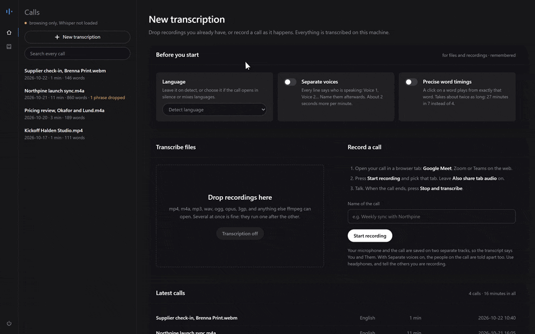

<p align="center">
  
</p>

<h1 align="center">Sottovoce</h1>

<p align="center"><strong>Call transcription that runs on your own computer, and shows you where the text can't be trusted.</strong></p>

<p align="center">
  <a href="https://github.com/thetouchsite/sottovoce/actions/workflows/tests.yml"></a>
  <a href="https://github.com/thetouchsite/sottovoce/releases"></a>
  <a href="LICENSE"></a>
  
  
</p>

<p align="center">
  <a href="https://thetouchsite.github.io/sottovoce/">Documentation</a> ·
  <a href="#quick-start">Quick start</a> ·
  <a href="#how-it-compares">How it compares</a> ·
  <a href="README.it.md">Italiano</a>
</p>



Drop a recorded call on the page, or record the call from it. You get the transcript, who said what, a summary, notes for the client's folder, the follow-up email, and a map of the places to double-check. Whisper large-v3 on your GPU. Nothing leaves the machine.

## Why Sottovoce

- **It shows where the text is weak.** The *call strip* draws the whole recording as one band: speech, silence, phrases removed, lines corrected. Click anywhere to listen from there.
- **It removes what nobody said.** On silence, Whisper writes subtitles it learned from YouTube: *"Thanks for watching"*. Sottovoce drops them only where the audio is far below speech, and lists every removal. On a public test with long pauses it adds 47 words nobody said, where Whisper alone adds 318 ([measured](docs/benchmarks.md#long-pauses)).
- **It knows who spoke.** A call recorded from the browser keeps your microphone and the call on two tracks: *You* and *Them* are measured, not guessed. On any recording, voices are told apart with no account and no token, at a [12% error rate on public meetings](docs/benchmarks.md#telling-voices-apart).
- **It keeps your names right.** A glossary fixes client and product names after transcription, and can be applied again to older calls.
- **It stays on your machine.** No account, no telemetry, no remote LLM. Every call is a folder of plain files; summaries and emails are written by a model that runs locally.

## Quick start

One command, nothing to install first: it brings its own Python, needs no administrator rights, and picks the PyTorch that sees your GPU.

**Windows**, in PowerShell:

```powershell
irm https://raw.githubusercontent.com/thetouchsite/sottovoce/main/installer/install.ps1 | iex
```

**Linux and macOS**, in a terminal:

```sh
curl -fsSL https://raw.githubusercontent.com/thetouchsite/sottovoce/main/installer/install.sh | bash
```

Then open **Sottovoce** from the Start menu or the desktop. On Windows it is a program of its own: one window, and an icon by the clock where it keeps working when you close the window; **Quit** in the icon's menu stops it. On Linux it starts from the applications menu, on a Mac from `~/Applications`, and opens in the browser. Your calls are kept in a `Sottovoce` folder in your home folder. To update, run the same command again. An NVIDIA GPU is what makes it fast; without one, and on a Mac, it runs on the CPU.

The first start downloads Whisper large-v3 (2.9 GB, once). Then drop a recording on the page, choose the language and the options, and press **Transcribe**.

**No GPU at hand?** Browse the four fictional calls in `examples/`:

```sh
pip install -r requirements-dev.txt
python server.py --no-model --data examples/transcripts --glossary examples/glossary.txt
```

Installing from a clone, updating, removing, the command line and the API: [Getting started](docs/getting-started.md).

## How it compares

| | **Sottovoce** | [Meetily](https://github.com/Zackriya-Solutions/meetily) | [Vibe](https://github.com/thewh1teagle/vibe) | [noScribe](https://github.com/kaixxx/noScribe) | [Buzz](https://github.com/chidiwilliams/buzz) | [WhisperX](https://github.com/m-bain/whisperX) |
| --- | --- | --- | --- | --- | --- | --- |
| Records calls | Browser tab + mic, **on two separate tracks** | Mic + system audio | Mic, system audio, phone | Files | Mic, live | Files |
| Who spoke | Two tracks, or voices **with no account** | Pro edition, coming soon | Yes | Yes (pyannote) | Yes | Yes (Hugging Face token) |
| Summaries | **Local only**: built-in model, LM Studio, Ollama | Ollama or cloud APIs | Ollama or Claude API | – | Plugin | – |
| Shows where the text needs checking | **Call strip, removals listed** | – | – | – | – | – |
| Interface | Web page, computer and phone | Desktop app | Desktop app | Desktop app | Desktop app | Command line, Python |
| GPU | NVIDIA | Apple, Vulkan; CUDA from source | NVIDIA, AMD, Intel, Apple | NVIDIA, Apple Silicon | NVIDIA, Apple Silicon, Vulkan | NVIDIA |
| Installer | Scripts | Windows, macOS | Windows, macOS, Linux | Windows, macOS, Linux | Windows, macOS, Linux | pip |
| Licence | MIT | MIT, paid Pro | MIT | GPL-3.0 | MIT | BSD-2-Clause |

<sub>From each project's README on 23 October 2026. If something has changed, open an issue and the table will be fixed.</sub>

Sottovoce is built for business calls: recorded or recorded here, read and corrected, filed with the client. If you need any GPU, a native desktop app or live captions today, Vibe and Buzz are excellent choices.

## FAQ

**Does anything leave my computer?**
No. Transcription, voice separation and summaries run locally, and the page loads nothing from the internet. Models are downloaded once, on first use, from Hugging Face and GitHub. See [SECURITY.md](SECURITY.md).

**Which GPU do I need?**
An NVIDIA card. Whisper large-v3 runs on it in half precision; the built-in summary model needs about 8 GB more, or use LM Studio or Ollama with a smaller one. Without an NVIDIA GPU it runs on the CPU, much slower.

**Which languages?**
Whisper understands many and detects the language by itself. Sottovoce is measured on Italian and English, and its page is in both.

**Can I use it under the GDPR?**
Recordings, transcripts and summaries never reach a third party: no cloud processor, no transfer outside your machine. You remain the controller, so the usual duties stay yours: tell participants they are recorded, have a legal basis, decide how long to keep the files. They are plain folders you can delete.

**Can I use it from my phone?**
Yes, on your Wi-Fi with `--lan` and a PIN: read, correct, send recordings, share the follow-up email. See [From your phone](docs/lan.md).

**How good is it?**
On public Italian speech ([FLEURS](docs/benchmarks.md#italian-read-speech)) 4.3% of words come out wrong, the same as Whisper large-v3 alone; on whole English meetings ([AMI](docs/benchmarks.md#english-meetings-whole)) 25.4%, against 30.3%. Every figure we publish comes from a script in `research/` you can run: [Benchmarks](docs/benchmarks.md). What it doesn't do well yet: [Limitations](docs/limitations.md).

## Documentation

[Getting started](docs/getting-started.md) · [How it works](docs/how-it-works.md) · [Recording a call](docs/recording.md) · [Telling voices apart](docs/voices.md) · [Summaries, notes and follow-ups](docs/summaries.md) · [The name glossary](docs/glossary.md) · [From your phone](docs/lan.md) · [Benchmarks](docs/benchmarks.md) · [Limitations](docs/limitations.md) · [Troubleshooting](docs/troubleshooting.md)

Also on the web: **[thetouchsite.github.io/sottovoce](https://thetouchsite.github.io/sottovoce/)**.

## For teams and companies

Sottovoce is built and maintained by **[TouchSite Software](https://www.touchsitesoftware.it)**. For firms that handle confidential calls (law, accounting, healthcare, HR) we install it on your machines, build glossaries for your sector and clients, connect it to the tools you already use, and support it.

**[info@touchsitesoftware.it](mailto:info@touchsitesoftware.it)**

## Contributing

Issues and pull requests are welcome: see [CONTRIBUTING.md](CONTRIBUTING.md) and the [roadmap](ROADMAP.md). Security problems: please report them privately, as described in [SECURITY.md](SECURITY.md).

## Licence

[MIT](LICENSE) © 2026 TouchSite Software. Third-party parts keep their licences: Whisper large-v3 (Apache-2.0), Qwen3 4B Instruct (Apache-2.0), pyannote segmentation-3.0 (MIT), 3D-Speaker ERes2Net (Apache-2.0), sherpa-onnx (Apache-2.0), Public Sans (SIL OFL 1.1), ffmpeg (through `imageio-ffmpeg`, not shipped here). The models are downloaded on first use, not shipped in this repository.

*Sotto voce* is Italian for "in a low voice": the phrases that fall below the level of speech are the ones it removes, and it works quietly, on your own machine.
