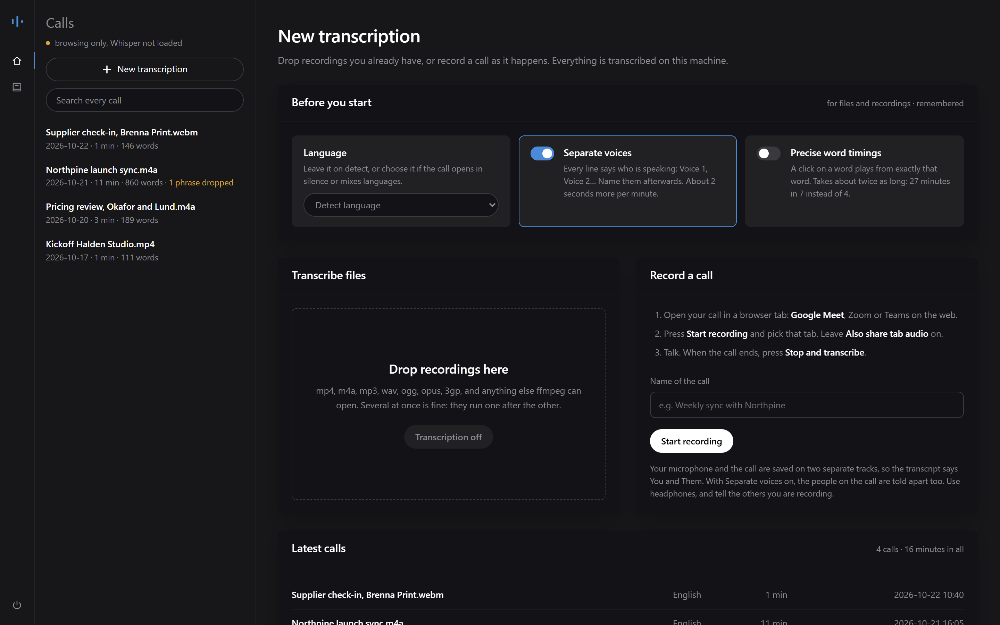

# Getting started

## What you need

- **A GPU helps, and isn't required.** Whisper large-v3 runs on whatever the computer has, the fastest first: an NVIDIA card through PyTorch, an Intel GPU (Arc, or the one built into the processor) through OpenVINO, or the processor itself, Intel or AMD, through OpenVINO. On the laptop measured, an hour of call takes about 6 minutes on its Intel GPU, 8 on its NVIDIA card, 12 on its processor ([where it runs](benchmarks.md#where-it-runs)). A smaller computer is slower; the page shows how long it takes on yours.
- **For summaries:** the built-in model needs an NVIDIA GPU with about 8 GB free ([measured](benchmarks.md#the-built-in-summary-model)). Without one, use a model you already have in LM Studio or Ollama ([how](summaries.md#which-model-writes-them)).
- **Nothing else to install first.** The setup and the installer bring their own Python. From a clone, you need Python 3.10 or newer.
- **Chrome or Edge**, to record calls from the browser on Linux and macOS.
- About **2 to 3 GB** of disk for Whisper (2.9 GB for an NVIDIA card, 1.5 GB through OpenVINO), and **8 GB** more if you use the built-in summary model.

## Install

=== "Windows"

    Download **Sottovoce-Setup.exe** from the [latest release](https://github.com/thetouchsite/sottovoce/releases/latest) and open it. It needs no administrator rights. The setup is not signed yet, so Windows may say it *protected your PC*: **More info**, then **Run anyway**. After copying the program it downloads, once, Python and the parts that suit this computer's GPU, with a progress bar.

    Or, in PowerShell, the same install with one command:

    ```powershell
    irm https://raw.githubusercontent.com/thetouchsite/sottovoce/main/installer/install.ps1 | iex
    ```

    Then open **Sottovoce** from the Start menu or the desktop. It opens in a window of its own, with an icon by the clock:

    - **Closing the window** hides it: Sottovoce keeps working there, and a transcription goes on. A notice by the clock says when it's done.
    - **Clicking the icon**, or the shortcut again, brings the window back.
    - **Right-click the icon** for the folder of your calls, **Start with Windows**, and **Quit**, the only way to stop it and free the GPU's memory.

=== "Linux and macOS"

    In a terminal:

    ```sh
    curl -fsSL https://raw.githubusercontent.com/thetouchsite/sottovoce/main/installer/install.sh | bash
    ```

    Then open **Sottovoce** from the applications menu (Linux) or `~/Applications` (macOS), or run the launcher the installer names at the end. A Mac needs Apple silicon: PyTorch no longer ships for Intel Macs.

=== "From a clone"

    For development, or to follow `main`. You need Python 3.10 or newer.

    ```sh
    git clone https://github.com/thetouchsite/sottovoce
    cd sottovoce
    python -m venv .venv
    # Windows: .venv\Scripts\activate    Linux/macOS: source .venv/bin/activate
    python installer/gpu.py                  # which PyTorch: cu130, cu126, cpu or pypi
    pip install torch --index-url https://download.pytorch.org/whl/cu130   # the one it said
    pip install -r requirements.txt          # OpenVINO comes with it, on x86-64
    cp glossary.example.txt glossary.txt
    python transcribe.py --where             # where Whisper will run here
    python server.py
    ```

    PyTorch goes first, from its own index: see [the PyTorch trap](troubleshooting.md#the-nvidia-gpu-is-not-used). On a Mac, `pip install torch` from PyPI. The calls are kept in `transcripts/` inside the clone. `installer/start.cmd` (Windows) and `installer/start.sh` start the server and open the page once it answers.

The first transcription downloads Whisper large-v3, once, after asking: 2.9 GB for PyTorch on an NVIDIA card, 1.5 GB for OpenVINO. Whisper is loaded when a transcription needs it, in about ten seconds, and leaves ten minutes after the last one: Sottovoce left open holds the GPU only while it works.

### Where Whisper runs

**Settings → Transcription** shows the ways this computer can run Whisper, how long an hour of call takes on each, and which one is in use. Sottovoce picks by itself: the NVIDIA card, else the Intel GPU, else the processor. A computer with more than one, like a laptop with both an NVIDIA card and an Intel GPU, can **measure which is fastest**: three minutes of your latest call through each, once; the fastest is then used. It isn't always the one you'd guess: on the laptop measured, the Intel GPU built into the processor beat the NVIDIA card ([numbers](benchmarks.md#where-it-runs)).

On a slow computer, **Faster model, turbo** uses Whisper large-v3-turbo: about twice as fast on an Intel GPU or a processor ([measured](benchmarks.md#where-it-runs)), with more mistakes, above all on names.

`SOTTOVOCE_ENGINE=cuda`, `intel-gpu` or `cpu` forces a path, for trying one against another.

### What the installer does

1. Downloads [uv](https://github.com/astral-sh/uv) (MIT or Apache-2.0) at a fixed version, checked against its SHA-256.
2. Downloads the latest release of Sottovoce.
3. With uv, installs Python 3.12 and a virtual environment, all inside the program folder.
4. Asks `installer/gpu.py` which PyTorch sees your GPU: CUDA 13.0 for RTX 20 to RTX 50 and GTX 16 with a driver 580 or newer, CUDA 12.6 for older cards or drivers, the CPU build without an NVIDIA GPU. It installs that one first ([why](troubleshooting.md#the-nvidia-gpu-is-not-used)), then the rest, OpenVINO included (about 260 MB).
5. Creates the folder for your calls, the shortcuts and, on Windows, the entry in **Settings → Apps**.

| | Windows | Linux | macOS |
| --- | --- | --- | --- |
| The program | `%LOCALAPPDATA%\Programs\Sottovoce` | `~/.local/share/sottovoce` | `~/Library/Application Support/Sottovoce` |
| Your calls and the glossary | `%USERPROFILE%\Sottovoce` | `~/Sottovoce` | `~/Sottovoce` |
| The models | `%USERPROFILE%\.cache\huggingface` | `~/.cache/huggingface` | `~/.cache/huggingface` |

Your calls are not in *Documents* on purpose: on many Windows computers OneDrive keeps a copy of *Documents* in the cloud, and the calls must not leave the machine.

### Updating and removing

**Update:** stop Sottovoce, then open the new setup, or run the same install command again. Only what changed is downloaded; your calls, the voice models and the PIN your phone knows stay.

**Remove:** on Windows, **Settings → Apps → Sottovoce → Uninstall**; on Linux and macOS, run `uninstall.sh` in the program folder. It removes the program, the shortcuts and the start with Windows, then asks whether to delete your calls too, and the models Sottovoce downloaded (only those, not the rest of the cache). No keeps them. Yes to both leaves the computer as it was.

## Try it without a GPU

The `examples/` folder has four fictional calls, already transcribed: one in Italian, one recorded on two tracks, one with three named voices. Browse them without downloading anything:

```sh
pip install -r requirements-dev.txt
python server.py --no-model --data examples/transcripts --glossary examples/glossary.txt
```

Open <http://127.0.0.1:8200>. Everything works except transcribing and recording.

## Your first call



1. **Choose how**, in *Before you start*: the language (or let it be detected), **Separate voices**, **Precise word timings**. The choices are remembered.
2. **Add a recording.** Drop it on the page or onto the list of calls. It waits there, tagged *Not transcribed*: open it to listen, rename it, then press **Transcribe**. Or [record a call](recording.md) from the page.
3. **Read it.** Summary, paragraphs, line by line. Click a word to hear it. The call strip at the top shows where the text needs a look.

Any format ffmpeg can open works: mp4, m4a, mp3, wav, ogg, opus, 3gp, webm. The **IT** button at the bottom of the side bar switches the page to Italian. Stop the server with the power button at the bottom of the side bar, or by closing its window.

## Command line

```sh
python transcribe.py "Client call.mp4" --language it --formats txt,md,srt   # writes next to the file
python transcribe.py "Recording.webm" --two-tracks --precise
python transcribe.py "Team meeting.m4a" --voices
python server.py --port 8300 --data D:\calls --glossary D:\calls\names.txt
python server.py --no-model                                                 # browse only
python server.py --lan                                                      # open to your phone, with a PIN
```

The page talks to the server through a small HTTP API, documented at <http://127.0.0.1:8200/docs> while it runs: add and transcribe files from your own scripts, read a call as JSON, search, correct, rename, delete.

## Where your calls are

```text
transcripts/
  2026-10-21_Northpine launch sync/
    Northpine launch sync.m4a    the original recording
    Northpine launch sync.txt    [mm:ss] [Voice 2] text: the source of everything else
    Northpine launch sync.md     paragraphs, to read or paste
    words.json                   when each word was said
    info.json                    duration, language, voice names, what was removed
    corrections.jsonl            every corrected line, before and after
    summary.md                   the summary, if asked for
    followup.md                  the follow-up email, if asked for
```

No database: delete a folder and the call is gone; copy it and you have a backup. Calls deleted from the page are moved to `transcripts/_deleted/`, not erased.
