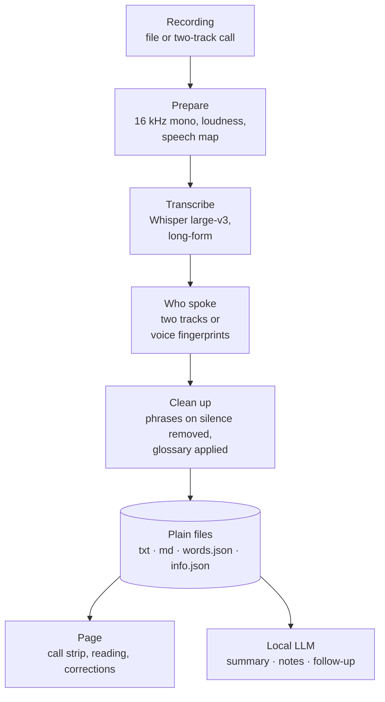
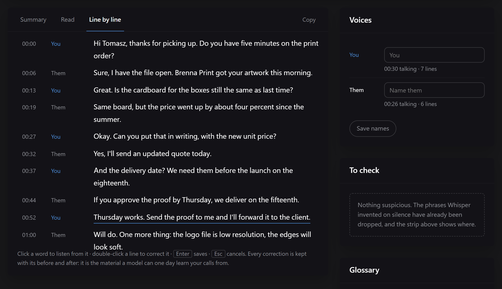

# How it works

## 1. Prepare

The recording is converted to 16 kHz mono and its loudness is normalized. A call recorded with a phone on the desk has one voice close and the others from the speaker; brought to one level, Whisper discards and retries fewer windows ([measured](benchmarks.md#other-settings)). A map of where people speak is measured from the audio and kept: it draws the call strip and decides, later, what counts as silence.

For a call recorded on two tracks, the tracks are mixed half and half for Whisper and kept apart for telling who spoke.

## 2. Transcribe

Whisper large-v3 runs on the whole recording in its own long-form mode, with its anti-hallucination settings on: temperature fallback, compression-ratio and log-probability thresholds, no conditioning on the previous window. The audio is not cut into chunks: chunking produced timestamps that went backwards and repeated phrases.

Word times come one of two ways. By default each line's time is shared among its words by their length, at no extra cost. With **Precise word timings**, Whisper aligns every word itself, at about twice the time ([measured](benchmarks.md#word-timings)).

## 3. Who spoke

- **Two tracks** (a call recorded from the page): your microphone is one track and the call is the other. Each Whisper line's words are laid over the moments someone actually speaks in it, and each word goes to the track that carries that moment.
- **Voices** (any recording, when asked): two small open models find who speaks when, by the sound of the voice. See [Telling voices apart](voices.md).

## 4. Clean up

- **Phrases on silence.** Whisper learned from YouTube subtitles and repeats them on silence. A line is removed only when both are true: its text is one of those phrases, and the audio at that point is more than 12 dB below the level of speech in that call. A real "thank you all" said in the call stays. Every removal is listed with its time, and drawn on the strip.
- **The glossary** corrects names after transcription. See [The name glossary](glossary.md).

## 5. Plain files

Everything is written next to the original recording, in one folder per call. The `.txt` is the source the rest is rebuilt from; corrections, glossary changes and voice names are applied to it and saved with their history. There is no database to back up or migrate.

## 6. Read, correct, summarize

The page reads the folder and shows the call strip, three reading views, the words you can click, and the panels for voices, phrases to check and the glossary. A line corrected by hand is saved with its before and after in `corrections.jsonl`: the dataset needed one day to fine-tune a model on your own calls.

Summaries, notes and follow-up emails are written by a local LLM. See [Summaries, notes and follow-ups](summaries.md).

## The code

| File | What it does |
| --- | --- |
| `transcribe.py` | The engine: ffmpeg, Whisper, who spoke, the clean-up, the output formats. Also a command-line tool. |
| `voices.py` | Telling voices apart: the two models, their download and checksums, the grouping. |
| `summary.py` | The local LLM: a running LM Studio, Ollama or llama-server, or the built-in model. |
| `server.py` | FastAPI: the API, the job queue (one transcription at a time), the files on disk. |
| `app/index.html` | The page: one file, no build step, no framework, its fonts next to it. |
| `research/` | The scripts behind every number in these docs. |
